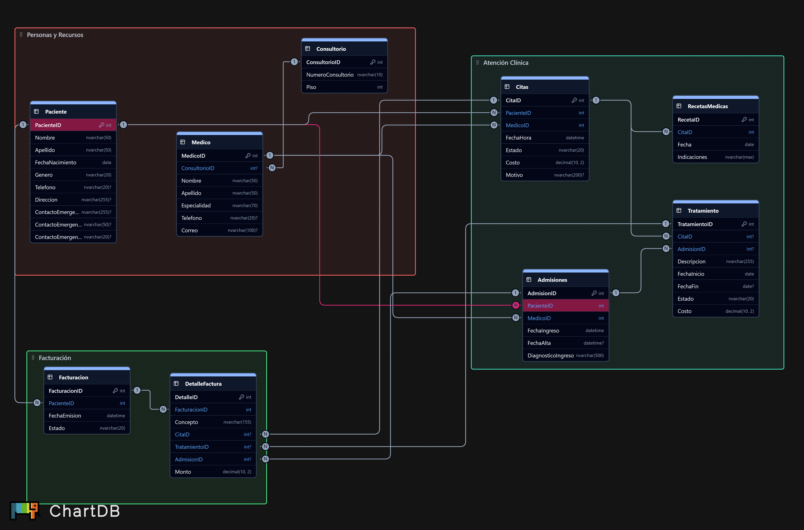

# Sistema de Gestión Hospitalaria (simplificada)

Proyecto de cátedra de **Administración de Bases de Datos** con **SQL Server**.
Base de datos: `GestionHospitalaria`.

**Integrantes**

- SOFIA NICOLE RODRIGUEZ CAMPOS
- GARY GEOVANNI SIBRIAN DERAS
- VINICIO ALONSO SIBRIAN VARGAS
- LUIS JOSE MURCIA PORTILLO

---

## Contenido del repositorio

| Carpeta / archivo | Qué contiene |
|---|---|
| `Sql/` | Scripts numerados de la base de datos (pasos 1 a 8) |
| `Datos/` | `pacientes_nuevos.csv`, archivo de ejemplo para la importación |
| `diagrama/` | Diagrama entidad-relación (`Diagrama_er.png`) |
| `dashboard/` | Dashboard de Power BI (`Dashboard_GestionHospitalaria.rar`, descomprimir para abrir el `.pbix`) |
| `docs/` | Documentación técnica completa en PDF (`Documentacion_tecnica-gestionHospitalaria.pdf`) |

---

## Requisitos

- SQL Server 2022 o 2025 (Developer)
- SQL Server Management Studio (SSMS)
- Power BI Desktop (solo para abrir el dashboard)

## Cómo ejecutar los scripts

Corre los archivos de la carpeta `Sql/` **en este orden**, abriendo cada uno en SSMS y pulsando **F5**:

| Paso | Archivo | Qué hace | Notas |
|---|---|---|---|
| 1 | `01_tablas.sql` | Crea la base (si no existe) y las 9 tablas con PK, FK, `CHECK`, `UNIQUE` y `DEFAULT` | **Borra y recrea las tablas** (se pierden los datos). Si ya habías corrido los pasos 3 y 4, vuelve a correrlos después. |
| 2 | `02_datos.sql` | Carga datos de prueba | Si ya hay datos, no inserta nada. Para recargar, corre antes el paso 1. |
| 3 | `03_vistas.sql` | Crea 3 vistas para Power BI | Se puede repetir sin problema. |
| 4 | `04_seguridad.sql` | Logins, usuarios, roles, permisos y enmascarado de datos | Requiere los pasos 1 y 3. |
| 5a | `05medicion_antes.sql` | Mide 3 consultas **sin** índices (plan real y lecturas lógicas) | Quita los índices del paso 5b para que el "antes" sea real. Correrlo **antes** que `05indices.sql`. |
| 5b | `05indices.sql` | Crea los índices y repite la medición ("después") | Se puede repetir sin problema. |
| 6 | `06_respaldo.sql` | Backup completo, diferencial y de log, y restauración de prueba | Correr por secciones y **una sola vez**. Ajusta las rutas si SQL Server corre en Windows. |
| 7 | `07_consultas_avanzadas.sql` | Consultas con funciones ventana (ranking, acumulados, `LAG`) | Solo lectura. |
| 8 | `08_importacion_csv.sql` | Importa `Datos/pacientes_nuevos.csv` con `BULK INSERT`, valida cada fila y pasa las buenas a `Paciente` | Detecta si SQL Server corre en Windows o Linux. Antes de correrlo copia el CSV donde lo lea el servidor (Windows: `C:\Temp\`; Docker: `docker cp` a `/var/opt/mssql/data/`). Resultado esperado: 30 filas leídas, 24 insertadas y 6 rechazadas. Si en Linux se dañan las tildes, esas filas se rechazan y se reporta el motivo. Se puede repetir sin duplicar. |

> Antes de empezar, confirma que el desplegable de base de datos de SSMS diga `GestionHospitalaria` (o que el script tenga su `USE`, como ya trae).

---

## Modelo de datos

9 tablas y 13 relaciones (todas 1:N):

| Tabla | Descripción |
|---|---|
| `Paciente` | Datos personales y contacto de emergencia |
| `Consultorio` | Número de consultorio y piso |
| `Medico` | Médicos, su especialidad y su consultorio |
| `Citas` | Citas entre un paciente y un médico, con estado y costo |
| `Admisiones` | Ingresos hospitalarios (con fecha de alta opcional) |
| `RecetasMedicas` | Recetas emitidas en una cita |
| `Tratamiento` | Tratamientos derivados de una cita **o** de una admisión |
| `Facturacion` | Cabecera de la factura de un paciente |
| `DetalleFactura` | Líneas de cada factura; cada una cobra una cita, un tratamiento o una admisión |

Decisiones de diseño:

- `Facturacion` no guarda el monto total: se calcula sumando `DetalleFactura` (evita datos inconsistentes).
- `Tratamiento` y `RecetasMedicas` no repiten paciente ni médico: se obtienen desde la cita o la admisión (3FN).
- Un médico no puede tener dos citas activas a la misma hora (índice único filtrado `UX_Citas_Medico_FechaHora`; las citas canceladas no cuentan).
- Los estados (`Estado`) están restringidos con `CHECK`.

---

## Datos de prueba (paso 2)

| Tabla | Filas |
|---|---|
| Paciente | 300 |
| Consultorio | 8 |
| Medico | 12 |
| Citas | 1500 |
| Admisiones | 120 |
| RecetasMedicas | 298 |
| Tratamiento | 418 |
| Facturacion | 710 |
| DetalleFactura | 1123 |

Al terminar, el script muestra el conteo de filas por tabla y el de citas y facturas por estado. Solo las citas atendidas tienen costo; las canceladas, las inasistencias y las programadas tienen costo 0.

---

## Vistas (paso 3)

| Vista | Para qué sirve |
|---|---|
| `vw_CitasDetalle` | Citas con paciente, médico, especialidad y consultorio ya unidos |
| `vw_FacturacionResumen` | Facturas con su monto total calculado (`MontoTotal`), y los montos `MontoPagado` y `MontoPendiente`. Para ingresos en Power BI se usa `MontoPagado`: `MontoTotal` incluye facturas anuladas |
| `vw_TratamientoDetalle` | Tratamientos con su paciente y médico |

Están pensadas para conectar Power BI sin dar acceso a las tablas.

---

## Seguridad (paso 4)

Cada rol tiene un login, un usuario y un rol en la base. Las contraseñas del script son **de ejemplo**: cámbialas.

| Rol | Puede | No puede |
|---|---|---|
| `rol_recepcion` | Ver y registrar pacientes y citas; ver médicos y consultorios; ver teléfonos completos | Ver recetas, tratamientos ni facturación; borrar pacientes o citas |
| `rol_medico` | Ver pacientes y citas; cambiar solo el `Estado` de una cita; registrar admisiones, tratamientos y recetas; ver teléfonos completos | Cambiar otras columnas de las citas; ver facturación |
| `rol_facturacion` | Gestionar facturas y su detalle; ver nombre y apellido del paciente, citas (**sin el motivo**), tratamientos y admisiones (**sin el diagnóstico**) | Ver recetas o teléfonos; borrar facturas |
| `rol_powerbi` | Leer las 3 vistas | Acceder directo a las tablas |

**Enmascarado de datos:** `Paciente.Telefono` y `Paciente.ContactoEmergenciaTelefono` se muestran como `XXXX-1234` a quien no tenga el permiso `UNMASK`.

---

## Dashboard de Power BI

Archivo: `dashboard/Dashboard_GestionHospitalaria.rar` (descomprimirlo para abrir el `.pbix` con Power BI Desktop).

- **Conexión:** modo **Importar**, con el login `lg_powerbi` (rol `rol_powerbi`, solo lectura sobre las 3 vistas). El servidor corre en Docker y se accede por `127.0.0.1,1434` (puerto 1434 del equipo hacia el 1433 del contenedor).
- **Actualizar datos:** los datos quedan guardados en el archivo y se pueden consultar sin el contenedor. Para actualizarlos se necesita acceso al contenedor Docker con la base y las credenciales del login `lg_powerbi`.

Áreas del dashboard:

| Área | Contenido |
|---|---|
| Resumen clínico | Total de citas e ingresos por citas (solo las atendidas tienen costo) |
| Citas por estado | Gráfico de anillo con atendidas, canceladas, no asistió y programadas |
| Análisis de consultas | Tabla de citas con fecha, paciente, médico, estado y costo; su total coincide con los ingresos del resumen |
| Indicadores clave | Total facturado (suma de `MontoPagado`), total y costo de tratamientos (sin contar los suspendidos), total de pacientes con al menos una cita y costo promedio por cita atendida |
| Operaciones | Costo de tratamientos por especialidad |
| Facturación por mes | Monto pagado y monto pendiente por mes, en el mismo eje |

Las visualizaciones de una misma vista se filtran entre sí. Entre vistas no hay relaciones, por lo que los filtros no se propagan (por ejemplo, seleccionar un estado en el anillo no cambia los tratamientos ni la facturación).

---

## Documentación

El informe técnico completo (modelo, diccionario de datos, reglas de negocio, vistas, carga de datos, seguridad, optimización con índices, consultas avanzadas, respaldo y recuperación, y evidencia del dashboard) está en `docs/Documentacion_tecnica-gestionHospitalaria.pdf`.

---

## Estado del proyecto

- [x] Diseño de la base de datos y diagrama ER
- [x] Tablas, datos de prueba y vistas (pasos 1 a 3)
- [x] Seguridad y sus pruebas (paso 4)
- [x] Importación de datos desde CSV (paso 8)
- [x] Medición "antes" e índices con medición "después" (paso 5)
- [x] Respaldo y recuperación (paso 6)
- [x] Consultas avanzadas con funciones ventana (paso 7)
- [x] Dashboard en Power BI conectado a las vistas
- [x] Documentación técnica en PDF