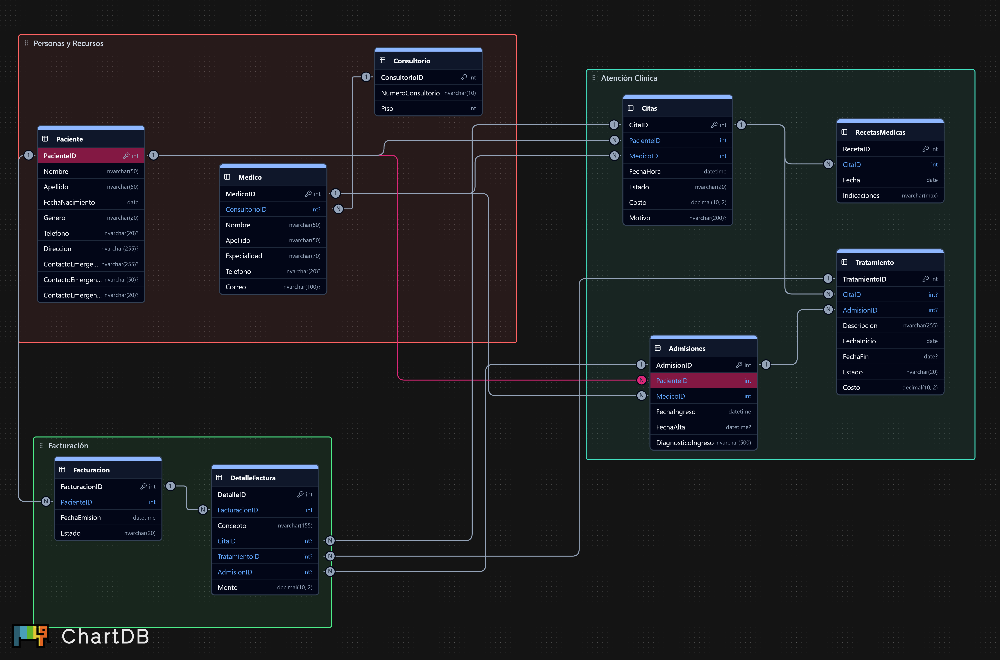

# Sistema de Gestión Hospitalaria (simplificada)

Proyecto de cátedra de **Administración de Bases de Datos** con **SQL Server**.
Base de datos: `GestionHospitalaria`.

**Integrantes**

-SOFIA NICOLE RODRIGUEZ CAMPOS
-GARY GEOVANNI SIBRIAN DERAS
-VINICIO ALONSO SIBRIAN VARGAS

---

## Requisitos

- SQL Server 2022 o 2025 (Developer)
- SQL Server Management Studio (SSMS)

## Cómo ejecutar los scripts

Corre los archivos de la carpeta `sql/` **en este orden**, abriendo cada uno en SSMS y pulsando **F5**:

| Paso | Archivo | Qué hace | Notas |
|---|---|---|---|
| 1 | `01_tablas.sql` | Crea la base y las 9 tablas con PK, FK, `CHECK`, `UNIQUE` y `DEFAULT` | **Borra y recrea las tablas.** Úsalo con la base vacía. |
| 2 | `02_datos.sql` | Carga datos de prueba | Córrelo **una sola vez**; si lo repites duplica filas. Si ya lo corriste, vuelve a correr el paso 1 antes. |
| 3 | `03_vistas.sql` | Crea 3 vistas para Power BI | Se puede repetir sin problema. |
| 4 | `04_seguridad.sql` | Logins, usuarios, roles, permisos y enmascarado de datos | Requiere los pasos 1 y 3. |

> Antes de empezar, confirma que el desplegable de base de datos de SSMS diga `GestionHospitalaria` (o que el script tenga su `USE`, como ya trae).

---

## Modelo de datos

9 tablas y 13 relaciones (todas 1:N):

| Tabla | Descripción |
|---|---|
| `Paciente` | Datos personales y contacto de emergencia |
| `Consultorio` | Número de consultorio y piso |
| `Medico` | Médicos, su especialidad y su consultorio |
| `Citas` | Citas entre un paciente y un médico, con estado y costo |
| `Admisiones` | Ingresos hospitalarios (con fecha de alta opcional) |
| `RecetasMedicas` | Recetas emitidas en una cita |
| `Tratamiento` | Tratamientos derivados de una cita **o** de una admisión |
| `Facturacion` | Cabecera de la factura de un paciente |
| `DetalleFactura` | Líneas de cada factura; cada una cobra una cita, un tratamiento o una admisión |

Decisiones de diseño:

- `Facturacion` no guarda el monto total: se calcula sumando `DetalleFactura` (evita datos inconsistentes).
- `Tratamiento` y `RecetasMedicas` no repiten paciente ni médico: se obtienen desde la cita o la admisión (3FN).
- Un médico no puede tener dos citas activas a la misma hora (índice único filtrado `UX_Citas_Medico_FechaHora`; las citas canceladas no cuentan).
- Los estados (`Estado`) están restringidos con `CHECK`.

El diagrama entidad-relación está en la carpeta `diagrama/`.

---

## Datos de prueba (paso 2)

| Tabla | Filas |
|---|---|
| Paciente | 300 |
| Consultorio | 8 |
| Medico | 12 |
| Citas | 1500 |
| Admisiones | 120 |
| RecetasMedicas | 298 |
| Tratamiento | 418 |
| Facturacion | 710 |
| DetalleFactura | 1123 |

Al terminar, el script muestra el conteo de filas por tabla y el de citas y facturas por estado.

---

## Vistas (paso 3)

| Vista | Para qué sirve |
|---|---|
| `vw_CitasDetalle` | Citas con paciente, médico, especialidad y consultorio ya unidos |
| `vw_FacturacionResumen` | Facturas con su monto total calculado |
| `vw_TratamientosDetalle` | Tratamientos con su paciente y médico |

Están pensadas para conectar Power BI sin dar acceso a las tablas.

---

## Seguridad (paso 4)

Cada rol tiene un login, un usuario y un rol en la base. Las contraseñas del script son **de ejemplo**: cámbialas.

| Rol | Puede | No puede |
|---|---|---|
| `rol_recepcion` | Ver y registrar pacientes y citas; ver médicos y consultorios; ver teléfonos completos | Ver recetas, tratamientos ni facturación; borrar pacientes o citas |
| `rol_medico` | Ver pacientes y citas; cambiar solo el `Estado` de una cita; registrar admisiones, tratamientos y recetas; ver teléfonos completos | Cambiar otras columnas de las citas; ver facturación |
| `rol_facturacion` | Gestionar facturas y su detalle; ver nombre y apellido del paciente, citas, tratamientos y admisiones **sin el diagnóstico** | Ver recetas o teléfonos; borrar facturas |
| `rol_powerbi` | Leer las 3 vistas | Acceder directo a las tablas |

**Enmascarado de datos:** `Paciente.Telefono` y `Paciente.ContactoEmergenciaTelefono` se muestran como `XXXX-1234` a quien no tenga el permiso `UNMASK`.

---

## Pendiente por hacer

Marca cada casilla (`[x]`) cuando esté lista.

**Hecho**

- [x] Diseño de la base de datos y diagrama ER
- [x] Tablas, datos de prueba y vistas (pasos 1 a 3)
- [x] Seguridad y sus pruebas (paso 4 )

**Por hacer**

| Hecho | Tarea | Qué entregar | Pts | Responsable |
|---|---|---|---|---|
| [ ] | **Importación real de datos** | Cargar datos desde un archivo CSV (asistente de SSMS o `BULK INSERT`), validarlos y pasarlos a la tabla real, como evidencia de migración | 5 | Vinicio |
| [ ] | **Medir "antes" de los índices** | Consulta de prueba con plan de ejecución real y lecturas lógicas, **antes** de crear los índices | 10 | Nombre 2 |
| [ ] | **Índices** | Script propio de índices (`05_indices.sql`, con `DROP INDEX IF EXISTS` + `CREATE INDEX`) y repetir la medición ("después") | 10 | Nombre 2 |
| [ ] | **Consultas avanzadas** | Consultas con funciones ventana (ranking, acumulados, `LAG`) | 10 | Nombre 2 |
| [ ] | **Respaldo y recuperación** | Backup completo, diferencial y de log, más una restauración de prueba | 10 | Nombre 2 |
| [ ] | **Dashboard en Power BI** | Archivo `.pbix` conectado a las vistas, con al menos 3 visualizaciones | 15 | Nombre 3 |
| [ ] | **Dimensionamiento** | Tamaño estimado de la base y plan de crecimiento de los archivos | informe | Nombre 3 |
| [ ] | **Informe** | Word/PDF de máximo 30 páginas. Cada quien entrega su sección con capturas; |  (con la presentación)  |
| [ ] | **Presentación** | Demo del sistema, consultas clave y dashboard final; cada quien presenta su parte | | Todos |
| [ ] | **Evidencias** | Capturas de cada paso guardadas en `docs/` | informe | Cada quien, de su parte |

**Secciones del informe por persona**

| Persona | Secciones |
|---|---|
| Vinicio | Introducción, diseño de la base de datos, carga de datos, seguridad |
| Nombre 2 | Optimización y consultas avanzadas, respaldo y recuperación |
| Nombre 3 | Dimensionamiento, dashboard en Power BI, conclusiones y formato final |
